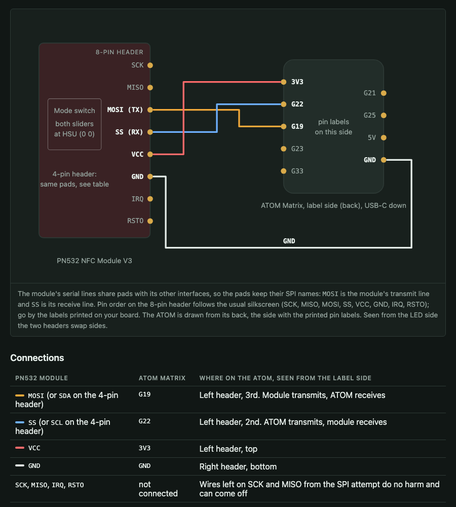
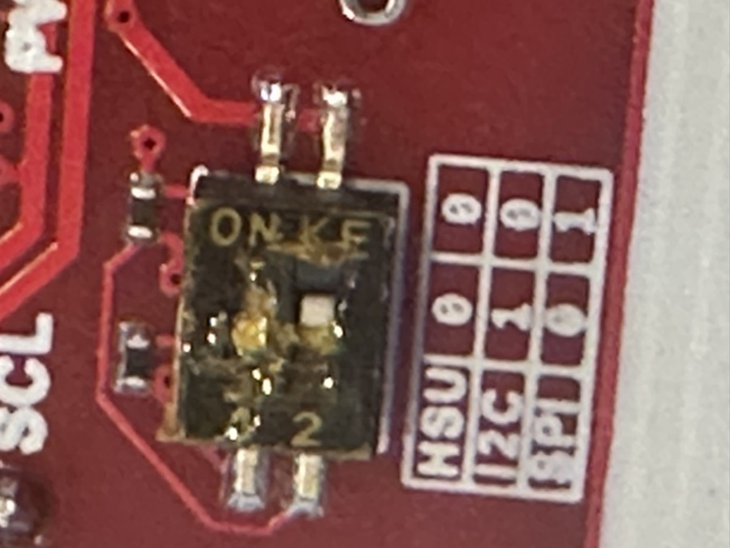
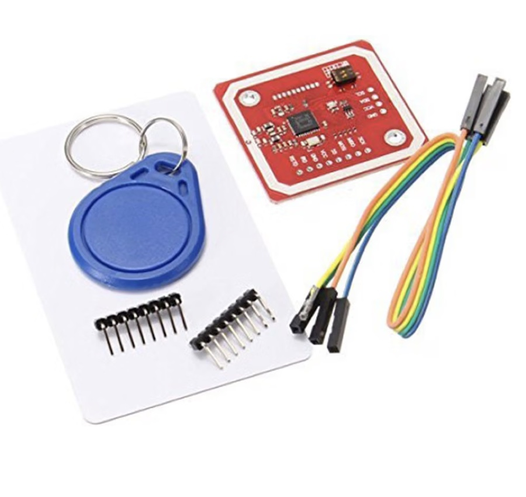

# NFCTapInXR

A Spectacles ('24) lens that turns NFC taps into things in the air. It started
as a copy of `../SpecsSwitchbackXR` and keeps that project's Bluetooth hub and
drawing helpers; the Switchback views (Pulse, Remote, Roll, Pin, Snap, Links)
are still in the scene but switched off.

The reader is `../../prototypes/NFCTapInXR_AtomMatrix_proto1`: an M5 ATOM
Matrix with a PN532, advertising as `NFCTapIn` and notifying `TAP <id hex>`
over the Nordic UART service, with no bonding.

## Scenes

| # | Scene | What happens |
|---|---|---|
| 0 | Trading card | An original creature card (Glimmerpup) turns to face you; pinch it to hold and move it |
| 1 | Sign-in | "Signing in as Iron Man": a spinner with three steps, then a check and "Session secured" |
| 2 | 3D model | Scan hoops sweep up while a model spins into existence |
| 3 | Fare | A transit pass slides in and its balance counts down by the $2.75 fare; when it can't pay, it tops itself up |

Under the stage are five pinch chips: one per scene, to play it without a tag,
and `RESET`, which forgets the learned tags and restores the balance to $20.00.

## What you need

| Part | Notes | Where to get it |
|---|---|---|
| Snap Spectacles ('24) | the glasses the lens runs on | [spectacles.com](https://www.spectacles.com/) (developer program) |
| Lens Studio 5.15 | to open this project and send it to the glasses | [Lens Studio](https://ar.snap.com/lens-studio) |
| M5Stack ATOM Matrix (or ATOM Matrix v1.1) | ESP32 with a 5x5 LED matrix; runs the reader firmware | [M5Stack docs](https://docs.m5stack.com/en/core/ATOM%20Matrix), [Adafruit 4497](https://www.adafruit.com/products/4497), [Pimoroni](https://shop.pimoroni.com/products/atom-matrix-esp32-development-kit) |
| PN532 NFC RFID Module V3 (red board) | the NFC reader, used in serial (HSU) mode; the kit comes with two MIFARE Classic tags (a white card and a key fob) | [Elechouse](https://www.elechouse.com/elechouse/images/product/PN532_module_V3/), [Makerfabs](https://makerfabs.com/pn532-nfc-module-v3.html), [Elecrow](https://elecrow.com/pn532-nfc-module-pn532-rfid-v3-module.html) |
| 4 female-female jumper wires | VCC, GND, TX, RX | any |
| USB-C cable | power and flashing for the ATOM | any |
| 4 NFC tags, one per scene | NTAG213/215/216 stickers or cards are the easy choice (see below) | [Tagstand NXP tags](https://www.tagstand.com/?s=nxp&post_type=product) (stickers, cards, fobs); also [GoToTags NTAG215 sticker](https://store.gototags.com/nfc-sticker-ntag215-25-mm-circle/), or any NTAG21x multipack |
| A phone with NFC (optional) | to read tag IDs with NFC Tools | [NFC Tools for iOS](https://apps.apple.com/us/app/nfc-tools/id1252962749), [NFC Tools for Android](https://play.google.com/store/apps/details?id=com.wakdev.wdnfc) |

The reader firmware, wiring and LED states are in
`../../prototypes/NFCTapInXR_AtomMatrix_proto1/README.md`. Short version:



Set the PN532's mode switch to the `HSU 0 0` row (both sliders pushed away
from the `ON KE` lettering) before powering it:



## Tags that work

Buy NXP tags (NTAG21x, MIFARE) from
[Tagstand](https://www.tagstand.com/?s=nxp&post_type=product).
The lens only needs a tag's ID (UID). Nothing has to be written to the tag,
so blank tags are fine and tags already holding a URL or other data work too.



*The PN532 V3 kit: the red reader board, the two MIFARE Classic tags it
comes with (white card and blue key fob), header pins and a 4-wire cable. The
card and the fob are two of the tags; add two more (NTAG stickers, say) for
four scenes.*

| Tag | Works | Notes |
|---|---|---|
| NTAG213 / 215 / 216 (stickers, cards, coins, wristbands) | yes | 7-byte ID, e.g. `04A2B3C4D5E680`. Cheap and the easiest to buy; recommended |
| MIFARE Ultralight / Ultralight C | yes | 7-byte ID |
| MIFARE Classic 1K / 4K (the white card and blue fob in the PN532 kit) | yes | 4-byte ID, e.g. `E7CE2607`. Only the ID is read, so the sector keys don't matter |
| MIFARE DESFire EV1/EV2/EV3 | yes | 7-byte ID, unless the card has been set to give a random ID |
| FeliCa, ISO14443B | read | the reader polls for them too; less tested |
| ST25TV, ICODE SLIX, other ISO15693 ("vicinity") tags | no | the PN532 cannot read ISO15693. This needs a PN5180, PN7150 or ST25R reader |
| Phones, watches and bank cards (Apple Pay, Google Pay, contactless cards) | no | they show a new random ID each time, so they can't be bound to a scene |
| 125 kHz tags (EM4100, HID Prox, most building key fobs) | no | a different radio band, not NFC |

If a tag isn't found at all, try it flat against the centre of the PN532's
antenna; stickers on metal don't read unless they are on-metal tags.

## Reading a tag's ID

Any of these gives you the ID to put in `TapTags.ts`:

1. **NFC Tools on a phone** ([iOS](https://apps.apple.com/us/app/nfc-tools/id1252962749),
   [Android](https://play.google.com/store/apps/details?id=com.wakdev.wdnfc)):
   open the app, choose **Read**, hold the tag to the phone. The ID is the
   **Serial number** line, e.g. `04:A2:B3:C4:D5:E6:80`. The **Tag type** line
   also tells you whether the tag will work (see the table above). On an
   iPhone the tag goes near the top edge; on Android near the middle of the back.
   Other readers such as NXP TagInfo show the same ID as "UID".
2. **The reader on USB**: with the ATOM plugged into a computer, open a serial
   console at 115200 baud (for example `pio device monitor -b 115200`) and tap
   the tag. The reader prints `TAP E7CE2607`.
3. **The lens itself**: tap an unknown tag with the lens running and the
   caption under the stage shows `UNKNOWN TAG <id>` (or `TAG <id>` while
   it is learning); the Spectacles log prints `[tapin] tap <id>`.

The ID can be copied in any spelling: colons, spaces, dashes and case are
ignored. The phone and the PN532 give the ID in the same byte order.

## Which tag plays which scene

Edit **`Assets/ProjectScripts/tap/TapTags.ts`**. It has one list per scene,
with a `TODO` where each tag ID goes:

```ts
export const TAG_SCENES: string[][] = [
  // 0 CARD
  ["04:A2:B3:C4:D5:E6:80"],
  // 1 SIGN-IN
  ["E7CE2607"],
  // 2 MODEL
  [],
  // 3 FARE
  ["04 11 22 33 44 55 66", "04AABBCCDDEEFF"],   // two tags can play one scene
];
```

Then send the lens to the glasses again. At start the lens log prints which
tags each scene has, e.g. `[tapin] ready; tags TRADING CARD=04A2B3C4D5E680 ...`.

- A scene with an empty list **learns**: the first unknown tag tapped is bound
  to the first scene that still has no tag, and remembered on the glasses
  until the `RESET` chip is pinched. With all four lists empty, the first four
  different tags play card, sign-in, model and fare in that order.
- With all four lists filled, an unknown tag shows
  `UNKNOWN TAG <id> : ADD IT TO TapTags.ts`.
- The four inputs on the `TapIn` object (`cardTag`, `signInTag`, `modelTag`,
  `fareTag`) add to these lists (comma-separated), for setting a tag from the
  Inspector without editing code.

## Scene setup

One object, `TapIn`, carries the `TapInXR` script. Its inputs:

| Input | Set to |
|---|---|
| `bluetoothModule` | the project's Bluetooth Central Module asset |
| `imageMaterial` | `Image` (unlit, base texture) |
| `textTemplate` | the Text on `TapIn/FontTemplate` (font source; hidden at start) |
| `camera` | `Camera Object` |
| `modelPrefab` | optional; a 3D model to materialize instead of the built-in crystal |

## Code

`Assets/ProjectScripts/tap/`:

- `TapLink.ts` holds the reader link as a staged connection: searching,
  connecting, subscribing, live. Each step has a time limit and none of them
  blocks the lens.
- `TapTags.ts` is the tag table: which tag IDs play which scene. This is the
  file to edit for your own tags.
- `TapInXR.ts` builds the stage and the four scenes and maps tags to scenes.
- `Paint.ts` paints the cards, rings and the creature into procedural
  textures, so the scenes need no image assets.

## The reader link

Until a tag is tapped, the stage shows the link to the reader step by step:

| State | What the stage shows |
|---|---|
| searching | "Looking for NFCTapIn", which scan of 2, and a progress bar |
| connecting / subscribing | "Found NFCTapIn, connecting", then "Opening the tap channel" |
| live | "Reader connected", and the TAP ring |
| lost | "Reader lost", searching again by itself (once) |
| notfound | "NFCTapIn not found", what to check, and a `RETRY` button |
| failed | "Could not reach the reader", the platform's message, and `RETRY` |

A search is two 7-second scans and then it stops with `notfound`; it does not
scan forever, because scanning is what makes a lens stutter. The scan carries
a native name filter, so only the reader's own advertisements reach the script.
The first scan starts 1.2 s after the lens, once the stage is drawn. The scene
chips work in every state. A connect or subscribe that hangs is given up after
12 s and 8 s and reported as `failed`. Bluetooth being refused or switched off
is reported as `failed` with the platform's text.

If the reader's matrix is solid green, another device is connected to it and
it has stopped advertising, so the glasses will report `notfound`.

## Running it

In the editor preview there is no Bluetooth, so the lens acts the link out
(a search that fails, an error, a retry that connects) and then plays the four
scenes in turn every 5 seconds (`previewDemo`). On the glasses it searches for
`NFCTapIn`; the caption under the stage shows the link state and each tap.

Keep the lens Bluetooth-only: with the WebView demos enabled the scan fails
with `PERMISSION_DENIED` (see `../SpecsSwitchbackXR/BLE-NOTES.md`).

## Promo video

A 30 s YouTube explainer is built from `promo/` (Blender picture, synthesized
music, ffmpeg mix); see `promo/README.md`.

## Status (2026-11-22)

Compiles and runs in the Lens Studio preview; the four scenes and every link
state were checked there by eye, the link states with a simulated link. The
tag table (`TapTags.ts`) compiles and loads in the preview; its four lists are
still empty stubs, so every scene learns. Not yet run on the glasses, so the
real Bluetooth link to the reader (including the native name filter and the
error texts the platform gives), pinch holding of the card, and sizes at real
scale are untested.
