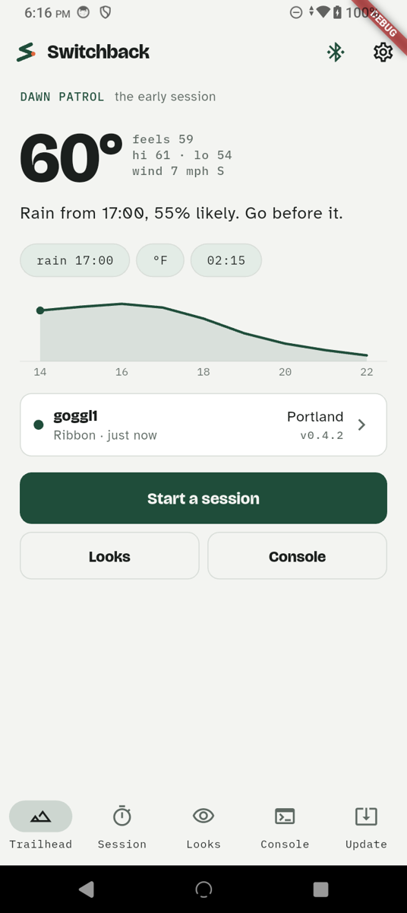
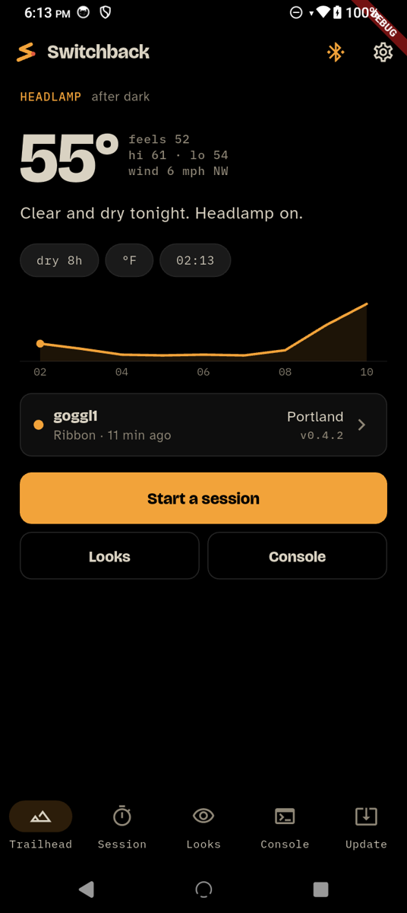
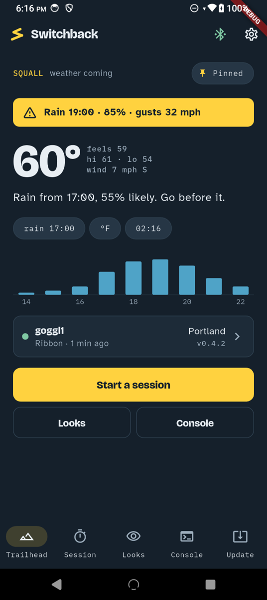
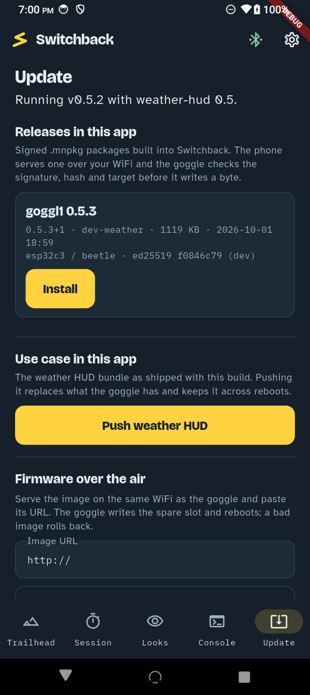

# Switchback

**Switchback** is the OpenWR phone app. Pair, set up, dress and update your
**goggl1** over Bluetooth, and run sessions with the glass in front of your
eye. Open. Weird. Wild. Strong. #PNWbuilt

> Package `switchback` · `io.iotone.switchback` · MIT · Android first.
> Started 2026-10-01 from `ProjectMagNET/magnet_app` (shell, BLE scanner,
> permissions flow, theme controller, EN/JA strings); the device protocol
> layer was replaced. Design: `../../prototypes/esp32c3_beetle_goggl1/docs/DESIGN-app-switchback.md`.

## What it does

The app never gets a protocol. The goggle exposes its Forth `ok>` prompt as
a Nordic UART Service, and every screen here is a form over lines the device
already understands. The Console tab is the whole app with the forms removed.

| Tab | Reads | Writes |
|---|---|---|
| **Trailhead** | `status`, `wx-dump` | |
| **Session** | | (phase E) `bundle-begin … bundle-end`, `sess!` |
| **Looks** | `status` | `n theme!`, `anim-on !`, `oled-contrast` |
| **Console** | everything | anything |
| **Update** | `version`, `bundle-info` | `s" http://<phone>:8777/<pkg>.mnpkg" ota!`, `bundle-begin … bundle-end` |
| Pair (from Trailhead) | scan for `goggl1` | |
| Setup (after pairing, or from the device card) | `geo-lat geo-lon geo-manual?` | `wifi!`, `geo!`, `geo-auto`, `units!` |

### Three experiences

The app's whole look follows the weather the goggle reports, chosen in
`ThemeController.choose` from the forecast dump: **Squall** when a storm,
rain with gusts of 40+, or a 70 % rain chance inside three hours;
**Headlamp** at night; **Dawn Patrol** otherwise. Pin one in Looks or
Settings; Headlamp has a red-shift toggle.

  

Verified 2026-10-01 on an Android 14 phone against a goggl1 in the room: a
long press on the goggle (or `pair` on its USB console) opens the window,
the Pair screen finds `goggl1` and connects by itself, Trailhead fills from
one `status` and one `wx-dump`, the theme picker shows the goggle's own
renders and switches the glass, and the experience moved from Dawn Patrol
to Headlamp when the goggle reported night.

### Updates from the phone

The app carries signed `.mnpkg` releases (the MagNET OTA package format)
under `assets/releases/`, listed in `releases.txt`. Install serves the
chosen package from a small HTTP server on the phone's WiFi address (port
8777), sends `ota!` to the goggle, follows the goggle's progress lines in
the console, and stops serving when the goggle reboots. The goggle verifies
the signature, hash and target itself; the app only reads the header to
show what a release is. The weather HUD bundle ships the same way, pushed
over the console. To ship a new release: build it in the firmware project
(`tools/mnpkg/mnpkg.py build …`), copy it into `assets/releases/`, add a
line to `releases.txt`.



## Run it

```bash
flutter pub get
flutter gen-l10n
flutter analyze && flutter test
flutter run -d <android device id>
```

The goggle must be in its pairing window to be found. Debug builds take a
few seconds to reach the first frame; that is Flutter, not the app.

## Layout

```
lib/
  main.dart               providers, the experience hook, the app
  app_router.dart         /, /pair, /radar, /looks, /console, /session, /settings, /diagnostics, /about
  goggle/
    nus_transport.dart    Nordic UART over flutter_blue_plus
    console.dart          GoggleConsole: connect, send → reply until ok>, status, forecast, the verbs
    status.dart           status line and wx-dump parsers, GlassTheme
  theme/
    tokens.dart           the three experiences, brand palette, type, buildAppTheme
    theme_controller.dart experience choice, pin, font scale, contrast, motion, red shift
  screens/                trailhead, pair, looks, console, session, update, settings, radar, diagnostics, about, first_run
  widgets/                forecast_graph, goggle_card
  shell/home_shell.dart   five tabs, the mark, the link indicator
  scanner/, perms/, l10n/ inherited
assets/fonts/             Bricolage Grotesque, Atkinson Hyperlegible, IBM Plex Mono (OFL)
assets/images/glass/      the goggle's theme renders, from the firmware repo
tool/gen_icon.py          the switchback mark → launcher icon and splash
```

## Phases

A rebrand and themes ✓ · B console, pairing, status, experience auto-select ✓ ·
C setup cards (WiFi, location, units) ✓ · D on-phone `.mnpkg` server, OTA, bundle push ✓ ·
E session. Verified 2026-10-01: a 1.1 MB release served from the phone
installed on the goggle and came back as 0.5.3 with the bundle intact.
