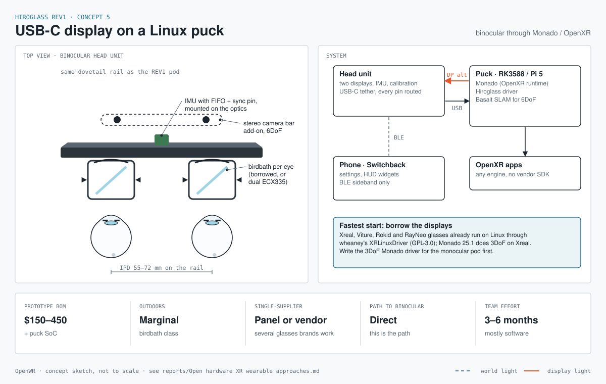

# Concept 5: Linux puck and display glasses

Status: **ready to start**, rewritten 2026-11-10. The team has an XREAL Air 2, adapters known to work with it, a Raspberry Pi 5, a Raspberry Pi 4 and an Orange Pi Zero 3. Nothing has to be bought to begin.

Sheet: [concept sheet](concept-5-usbc-monado.svg) · wiring: [schematics sheet X-5](../schematics/sheets/concept5-linux-puck.svg) · parts: [`bom/concept5-linux-puck.csv`](../bom/concept5-linux-puck.csv)

The sheet and the wiring diagram still show the original Monado-first design. This document supersedes them where they differ.

## What it is

The head unit is a display and sensors, nothing more. A small Linux computer (the puck) renders the picture and sends video down a cable; a motion sensor tells the puck where the head is pointing. This is the path from the REV1 HUD to binocular XR: it proves rendering, head tracking and stereo on optics we can buy, before we try to build binocular optics ourselves.

## What changed: no desktop, and Monado is no longer on the critical path

The first plan ran Monado, the open OpenXR runtime, on the puck. The product owner has tried that before with an XREAL Air 2 Pro and found the blocker:

> Monado on Linux needs a very specific set of desktop window-manager features. They are hard to get on Ubuntu or Debian and in practice need bleeding-edge releases.

Our reading of why, not yet confirmed against that test: Monado wants exclusive control of the headset's display. On a desktop it must get that from the window manager, through display leasing (DRM lease on Wayland, RandR leasing on X11), and support for that varies by desktop and version. It also helps if the kernel marks the display as a headset; we do not believe XREAL glasses are marked that way.

So the plan now has two routes:

| Route | What it is | Role |
|---|---|---|
| **A. Our own small renderer** | One program on the Pi draws fullscreen straight to the display from a bare console, with no window manager. It reads the motion data and draws the HUD panel fixed in space, then side by side for stereo. | **The path to the demo** |
| **B. Monado with no desktop** | Monado can drive a display directly from a console, with no window manager involved. | A timeboxed experiment beside route A |

What route A gives up: it is not OpenXR, so other people's XR applications will not run on it. For "the Hiroglass HUD as a spatial panel" that does not matter. If route B works, the same puck gains OpenXR later and route A's renderer becomes one OpenXR app among others.

## Which board is the puck

| Board on hand | Role | Why |
|---|---|---|
| Raspberry Pi 5 | **The puck** | Fastest of the three, with open graphics drivers |
| Raspberry Pi 4 | Fallback and second rig | Same driver family, slower. Useful for a second site or for comparing frame rates |
| Orange Pi Zero 3 | Not for rendering | Small GPU; fine as a headless helper. Its suitability for route B is not verified |

None of the three has DisplayPort on USB-C, so every one reaches the glasses through HDMI and an adapter.

## The question that still comes first: does head motion reach the puck?

The Air 2 sends its motion-sensor readings as USB data on the same USB-C cable that carries the video. Through an HDMI adapter the video arrives, but the USB data arrives only if the adapter passes USB through to a second port. Many carry only video and power.

- **If an adapter on hand passes USB data:** read the glasses' own sensor. Monado's XREAL Air driver (next section) is the reference to read.
- **If none does:** strap our own sensor to the glasses. The wiring sheet's BNO085 on a QT Py RP2040 does this (about $40), or any IMU board on the bench for a first try.

The test: with the glasses plugged in through the adapter, run `lsusb` on the Pi and look for `3318:0428`.

## Monado's XREAL Air driver

Monado ships a driver for these glasses: [Xreal Air driver](https://monado.pages.freedesktop.org/monado/group__drv__xreal__air.html) (author Tobias Frisch). What its documentation shows, read 2026-11-10:

| Fact | Detail |
|---|---|
| Our glasses are named | USB vendor `0x3318`. Product IDs: Air `0x0424`, **Air 2 `0x0428`**, Air 2 Pro `0x0432`, Air 2 Ultra `0x0426` |
| It talks to the glasses over USB HID | Two HID devices, one for sensor data and one for control. So the glasses' USB data must reach the puck; video alone is not enough |
| Head tracking is rotation only (3-DoF) | It reads gyro, accelerometer and magnetometer samples, fetches the glasses' calibration data, and fuses them with Monado's 3-DoF filter |
| It controls the glasses | Functions for brightness and for switching display mode |
| No lens correction | It applies no distortion mesh; the glasses are treated as a flat screen |

Files: `xreal_air_hmd.c` (device, sensor thread, fusion), `xreal_air_packet.c` (packet and calibration parsing), `xreal_air_interface.h` (the IDs), `target_builder_xreal_air.c` (device detection).

What this means for the two routes:

- **Route A** uses it as the protocol reference: packet layout, checksum, the start-IMU command and the calibration format are all in those files.
- **Route B** uses it directly. The driver existing does not remove the Air 2 Pro blocker: that was about Monado getting the display, not about the driver.

Not confirmed from the documentation pages: which display modes the driver sets (including side-by-side stereo), which USB interface numbers it opens, whether the detection code accepts all four product IDs, and the licence header of these files (Monado as a whole is Boost 1.0).

## Stages, route A

| Stage | What | Needs | Done when |
|---|---|---|---|
| A1 | **Picture.** Pi 5 with no desktop installed. A program draws a fullscreen test pattern through HDMI and an adapter to the Air 2. | Pi 5, Air 2, adapter (all on hand) | The pattern fills the glasses at 1920 x 1080; refresh rate recorded |
| A2 | **Motion.** Plug in each adapter and see whether the Air 2 appears as a USB device on the Pi. Read orientation from it, or from our own sensor if none passes USB. | A1; possibly an IMU board | Orientation numbers follow the head, printed on screen |
| A3 | **A panel fixed in space.** Draw one flat panel and counter-rotate it with the head. | A2 | The panel holds still as the head turns; drift per minute measured |
| A4 | **The Hiroglass HUD on the panel.** Show the same pages Switchback sends to goggl1. | A3, Switchback | Speed and heart-rate pages update live for 30 minutes |
| A5 | **Stereo.** Switch the glasses to side-by-side mode (3840 x 1080) and draw once per eye. | A4 | The panel sits at a chosen depth; real refresh rate recorded |
| Later | **6-DoF.** Two cameras and a tracker. | Stereo camera pair, time-synced IMU | Not planned for CES |

Stages A1 to A3 are card #41 on the board; A4 is card #42.

**Open design point for A4:** how the pages get from the phone to the Pi. goggl1 takes them as Forth console lines over Bluetooth. The Pi could offer the same Bluetooth service and run the same drawing words, or Switchback could gain a second transport. Decide at A3.

## Route B, the Monado experiment

Timebox: two days, after A1. It must not delay route A.

1. Build Monado on the Pi 5 with no desktop installed.
2. Start it in its direct-to-display mode from the console and run an OpenXR sample on the glasses.
3. If stage A2 found the glasses' USB data (`3318:0428` in `lsusb`), Monado's XREAL Air driver should pick the glasses up for head tracking.

Stop and write down what failed if any step takes more than half a day. Not verified in advance: that the direct mode works with the Pi's graphics driver, and that the XREAL driver works when video arrives by HDMI and only USB data comes from the glasses.

A shortcut worth knowing: a Linux laptop or mini PC with DisplayPort on USB-C takes the Air 2 directly, video and motion on one cable. It does not remove the window-manager problem unless it too runs without a desktop.

## Risks

- **The adapter passes no USB data.** Then head tracking needs our own sensor and its mounting, which adds a few days.
- **Frame rate on the Pi 5.** A single textured panel is light work, but nothing has been measured.
- **Drift.** Motion-sensor-only tracking drifts in yaw, so the panel slowly wanders. Acceptable for a demo; A3 measures it.
- **The optics are not open.** Only the software is. Four glasses brands have open or community drivers, so we are not tied to one.
- **Brightness.** Birdbath glasses are marginal in sunlight. This is an indoor demo.
- **Route B may hit the same wall** the Air 2 Pro test did, if the missing feature was something other than display leasing.

## Parts on hand

| Part | Status |
|---|---|
| XREAL Air 2 | One, on hand |
| Adapters for the Air 2 | Several, known to work; models and USB pass-through still to be recorded here |
| Raspberry Pi 5 | On hand: the puck |
| Raspberry Pi 4 | On hand: fallback |
| Orange Pi Zero 3 | On hand: helper only |

Two more Air 2 units are needed only if concept 5 is picked for CES and gets the usual three units. XREAL no longer sells the Air 2 on its own in Japan.

## Not checked

- Which adapters the team has, and whether any passes the glasses' USB data.
- Which distro and desktop the Air 2 Pro test used, and exactly which feature was missing.
- The Pi 5's memory size, and whether its power supply and cooler are on hand.
- The Air 2's motion-sensor rate, and its stereo refresh rate (the spec says 90 Hz, one user reports 60 Hz).
- Which library route A's renderer should use to draw without a window manager on Raspberry Pi OS.
- The source of Monado's XREAL Air driver; only its documentation pages were read (see that section for what is unconfirmed).
- Everything listed as unverified under route B.
