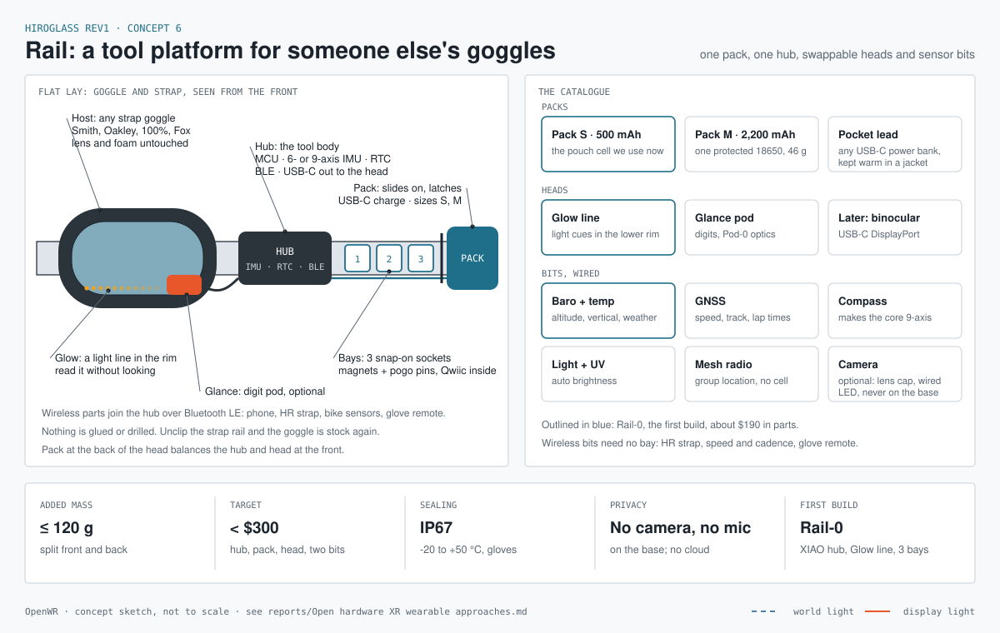
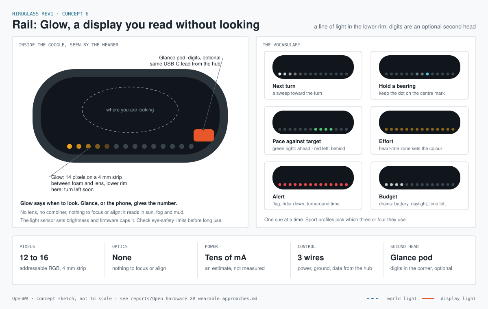
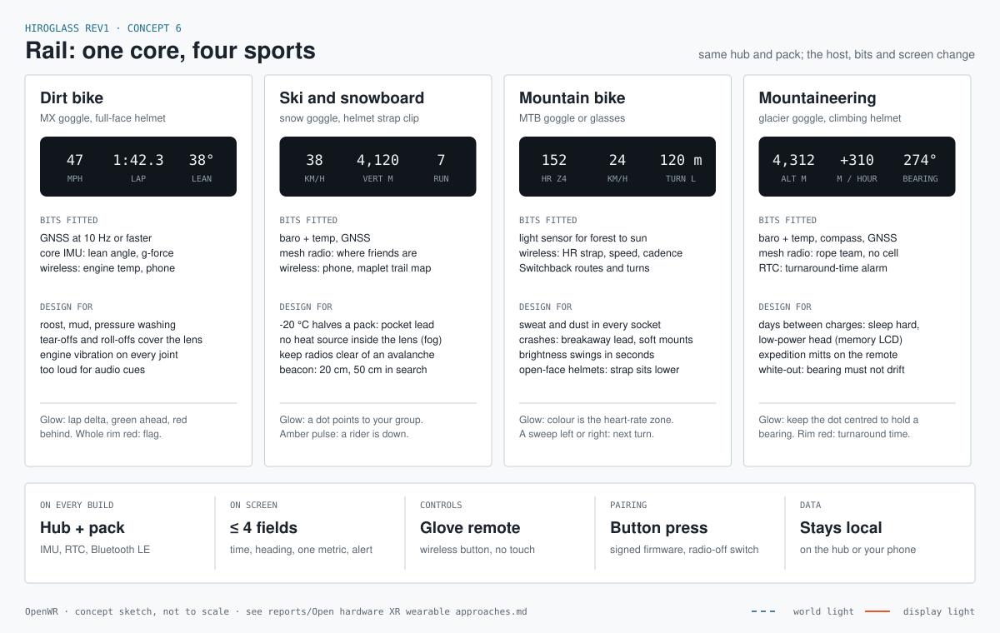

# Concept 6: Rail, a tool platform for someone else's goggles

Status: **ideation**, 2026-11-10. Nothing here is built or ordered. "Rail" is a working name.

Sheets: [platform](concept-6-rail-platform.svg) · [Glow](concept-6-rail-glow.svg) · [four sports](concept-6-rail-sports.svg)

## The idea

Cordless tool makers sell one battery and many tools. The battery, the latch and the contacts are the platform; the drill and the saw are things you clip onto it. Rail does the same for goggles, with one difference: the interfaces are open, so nobody is locked in.

- We do not make goggles. The **host** is a goggle someone already trusts for impact and fog: Smith, Oakley, 100%, Fox, Julbo. Its lens, foam and frame are never modified.
- We make what clips to it: a **strap rail**, a **pack** (battery), a **hub** (the tool body), a **head** (the display, on USB-C) and **bits** (sensors).
- One hub and one pack serve every sport. The host, the bits and the screen layout change.

## Where it comes from: Seeed's reGoggles

Seeed announced reGoggles on 2026-11-06 as an open smart-goggle platform for industrial work. It is pre-launch: an Early Builder Program is due to open at the end of November and Seeed says details may change. The blog and product page block automated reading, so the facts below come from search results and the two images the product owner supplied.

| reGoggles | Rail |
|---|---|
| Its own goggle shell | Any strap goggle from an eyewear maker |
| 12 MP camera, three microphones and two speakers built in | No camera, microphone or speaker on the base. A camera is an optional bit with a lens cap and a hard-wired LED |
| Linux-class Allwinner V881 with Wi-Fi and BLE; data can go to cloud LLMs | Microcontroller hub, Bluetooth LE only by default, no cloud, no account |
| Main firmware open; the audio and Bluetooth chip's firmware is closed | Whole stack open (ESPIDFORTH, Switchback), signed releases |
| Two expansion ports (MIPI CSI for cameras, ToF, SD, custom modules) | Three low-speed sensor bays plus wireless bits; USB-C to the head |
| Battery pod at the back of the strap, 6-DoF IMU | Same two ideas, kept |
| No display confirmed in what we could read: a capture and audio device | A display is the point: a HUD first |

What we keep: the rear battery pod as a counterweight, an IMU at the core, expansion as a first-class feature, building in the open. What we drop: the always-present camera and microphones, the cloud path and the closed radio firmware. A device with those on your face is a security question in a home or workplace before it does anything useful; see issue #19 on camera privacy.

## The parts

| Part | What it is | First guess |
|---|---|---|
| **Host** | An unmodified strap goggle | Whatever the builder owns; straps are 40 to 50 mm wide |
| **Strap rail** | A printed or moulded sleeve that grips the strap and carries the hub, bays and power bus | TPU print, silicone-backed, adjustable for strap width |
| **Pack** | A battery that slides on and latches at the back of the head | S: the 500 mAh pouch cell from the bench kits. M: one protected 18650, 2,200 mAh, 46 g. Charges over its own USB-C |
| **Pocket lead** | A USB-C cable to any power bank kept in a jacket | For cold days and long days; needs no pack at all |
| **Hub** | The tool body, at the temple | ESP32-C3 or C6, BMI270 (6-axis), RTC with backup, power path, USB-C out to the head |
| **Head** | The display, powered and fed over USB-C | **Glow**, a line of light in the lower rim, first. **Glance**, a digit pod with Pod-0 optics, second. Binocular later |
| **Bits, wired** | Sensors that drop into a bay | Baro + temperature, GNSS, compass (makes the core 9-axis), light + UV, mesh radio |
| **Bits, wireless** | Anything already speaking Bluetooth LE | HR strap, speed and cadence sensors, a glove remote, the phone |

### The core every build has

- **Motion:** a 6-axis IMU in the hub. Adding the compass bit makes it 9-axis; the firmware fuses whichever it finds.
- **Time:** a real-time clock with its own backup, so logs and alarms are right with the phone off.
- **Personal area network:** Bluetooth LE. The hub is central and peripheral at once: it reads sensors and serves the phone. goggl1 already runs two links.
- **Power:** one 5 V bus along the strap from the pack to the hub; USB-C from the hub to the head.

### Three interfaces to settle

These are the platform. Everything else can change later.

1. **Pack to rail.** A slide and a latch you can work with gloves, plus contacts for 5 V, ground and a fuel-gauge line. Open question: pogo pins on the rail, or simply a short USB-C plug so any power bank is a pack.
2. **Hub to head.** USB-C. Start with power plus I2C or SPI on the spare pins for a Pod-0 style head; keep the pins that DisplayPort needs free for a binocular head later.
3. **Bay to bit.** Six pins: 3.3 V, ground, SDA, SCL, interrupt, ID. Each bit carries a small ID memory so the hub knows what was plugged in. Open question: sealed magnetic pogo contacts (weatherproof, custom) or Qwiic / STEMMA QT (hundreds of existing sensors, not sealed).

## The build we would make today: Rail-0

The brief was the coolest approach that can be built now. These are the choices, each made so that Rail-0 needs no custom PCB and only parts seen in stock on 2026-11-10.

### 1. Glow: a display you read without looking

The first head is not a screen. It is a line of 12 to 16 addressable RGB pixels on a 4 mm strip, tucked between the face foam and the lens along the lower rim, in peripheral vision.

- **Why it is the right first head.** A HUD inside a goggle needs a lens, a combiner, focus and alignment, and it fights fog, mud and sunlight. A light line needs none of that. It reads in snow glare and through a dirty lens, and it survives a wash.
- **What it says.** One cue at a time: a sweep toward the next turn, a dot to keep centred for a bearing, a bar for pace against target, a colour for heart-rate zone, a red rim for an alert, a draining line for battery or time left. The Glow sheet shows the six.
- **How it pairs with digits.** Glow says when to look. The number comes from Glance (the Pod-0 optics as a second head on the same lead) or from the phone at the next stop.
- **It is not a new idea.** Peripheral light cues exist on bike computers and in research. What is ours is making it a swappable head on an open platform, with one vocabulary across four sports.

### 2. Bits that snap on with magnets, with Qwiic inside

A bit is an ordinary Qwiic / STEMMA QT breakout in a small printed shell, wired to one half of a magnetic pogo connector. The bay on the rail carries the other half.

- This gets both things we wanted: the snap and self-alignment of a custom connector, and the hundreds of sensors that already exist.
- Rail-0 uses a five-pin pair: 3.3 V, ground, SDA, SCL and interrupt. The hub knows what was plugged in from the sensor's I2C address, so no ID pin is needed yet.
- The contacts are open to water. Rail-0 is a dry-weather proof of the idea; a sealed bay is the first thing a custom version must fix.

### 3. A pack that is ours, because power banks switch off

A light line and a microcontroller draw tens of milliamps. Power banks shut down below about 30 to 90 mA (Anker and Ugreen both say so), so "any power bank" does not work as the everyday pack.

- The pack is the Pod-0 puck in a slide-on shell: a protected cell and a charger board with a power path, charged over USB-C.
- It slides onto a dovetail at the back of the strap and latches, like a tool battery. Its contacts are another magnetic pair.
- The pocket lead stays in the catalogue for cold days, with a bank that has a low-current mode.

### 4. Group signals with no extra hardware

The hub's ESP32-C3 can run ESP-NOW beside Bluetooth LE. Espressif's coexistence table lists ESP-NOW transmit as stable with BLE, and receive as stable when Wi-Fi is in station mode.

- Riders in a group share a key by pressing their hub buttons together.
- A hub that detects a crash, or a marshal's hub, sends one short packet. Every rim in range pulses amber or red.
- Range is line of sight, a few hundred metres at best. The LoRa mesh bit covers the backcountry later.
- This is a courtesy signal, not a safety system. It must never be the only way to learn that someone is down.

### 5. Parts for Rail-0

Prices read on the sellers' pages on 2026-11-10 unless marked.

| Part | Choice | Price | Note |
|---|---|---|---|
| Hub MCU | Seeed XIAO ESP32C3 | $4.99 | Same board as bench kit B; Japan radio certificate; ESPIDFORTH runs on it |
| Core IMU | SparkFun BMI270 Qwiic | $14.95 | 6-axis |
| RTC | Adafruit PCF8523 (5189) + CR1220 | $5.90 | Coin-cell backup. DS3231 (5188, $13.95) if drift matters |
| Light sensor | Adafruit VEML7700 (4162) | $4.95 | Sets Glow brightness |
| Glow | Adafruit Ultra Skinny NeoPixel 1515 strip (4368) | $24.95 | 4 mm wide, 150 LEDs/m, 75 LEDs: enough for four heads. 33 in stock |
| Bays | 3 x Adafruit magnetic connector, five pins (5413) | $20.85 | 0.1 in pitch. Current per pin is not stated |
| Bit: baro | SparkFun BMP581 Qwiic (SEN-20170) | $22.95 | Adafruit's BMP390 and BMP581 are out of stock |
| Bit: compass | Adafruit MMC5603 (5579) | $5.95 | Makes the core 9-axis |
| Bit: GNSS | Adafruit Mini GPS PA1010D (4415) | $29.95 | 10 Hz, 5 g, antenna on board |
| Pack | Adafruit bq24074 charger (4755) + protected 18650 with lead (1781) | $24.90 | 2,200 mAh, 46 g. Or the 500 mAh cell (1578) for Pack S |
| Host | 100% Strata 2 goggle | from $29.95 | Search result, not the page. Accuri 2 from $49.95 |
| Glove remote | M5 NanoC6 button | on hand | `projects/prototypes/button_m5nanoc6_platformio` |
| **Total** | | **about $190** | Before shipping, printing filament and the Glance pod |

In Japan the same strip is at Switch Science (5,225 yen, from a search result), the XIAO is at Akizuki, and the bq24074 board is not sold: use the substitute found in the buildability check.

### 6. Bench tests before anything is printed

1. **Glow at cell voltage.** Adafruit states 5 V only for the strip and says nothing about 3.3 V data. Test it from 3.3 to 4.2 V. If it fails, the hub needs a 5 V boost for the head.
2. **Glow in the eye.** Wear it. Find the brightness that reads in daylight and the cap that is comfortable at night. Check photobiological limits for LEDs this close to the eye before any long session.
3. **Magnetic bays under vibration.** Clip a bit on, shake it, ride with it. Count I2C errors.
4. **ESP-NOW beside BLE** on the IDF version we use, with Switchback connected.
5. **Fit.** Does a 4 mm strip sit between foam and lens on the host goggle without lifting the seal?

## One core, four sports

The fourth item in the list was written "maintaineering"; this takes it as mountaineering.

| | Dirt bike | Ski and snowboard | Mountain bike | Mountaineering |
|---|---|---|---|---|
| Host | MX goggle over a full-face helmet | Snow goggle, strap clipped to the helmet | MTB goggle or glasses | Glacier goggle, climbing helmet |
| On screen | Speed, lap time, lean angle | Speed, vertical, run count | Heart-rate zone, speed, next turn | Altitude, climb rate, bearing |
| Bits | GNSS at 10 Hz or faster | Baro, GNSS, mesh radio | Light sensor | Baro, compass, GNSS, mesh radio |
| Wireless | Engine temperature, phone | Phone, maplet trail map | HR strap, speed, cadence | Rope team over mesh |
| Hardest problem | Mud, pressure washing, tear-offs over the lens, vibration | Cold battery, fog, avalanche beacons | Sweat, crashes, light that changes in seconds | Days between charges, thick mitts, white-out |

What all four share, and so what the core must do:

- **Glance, not read:** four fields at most, readable in under a second.
- **Gloves:** no touch surfaces. A wireless button on the bar, pole or strap.
- **Sealed:** IP67, working from -20 to +50 °C.
- **Light and balanced:** 120 g added at most, split between front and back.
- **Safe in a crash:** breakaway cable, soft mounts, nothing rigid between the lens and the eye.
- **Works alone:** no phone, no network and no account needed to ride.

Two sport-specific rules to design in from the start:

- **Avalanche beacons.** Electronics and radios near a 457 kHz transceiver can disturb it. Makers commonly say 20 cm in send mode and 50 cm in search. A goggle strap is far from a chest-worn beacon, but the pocket lead and the phone are not. Confirm the figures against beacon makers' guidance before any snow use.
- **Tear-offs and roll-offs.** A dirt-bike lens is covered by film that moves. The head must sit where the film does not pass, or inside the lens.

## Security and privacy stance

- No camera, microphone or speaker on the base unit.
- A camera, if ever wanted, is a removable bit with a physical lens cap and an LED wired to its power, not to firmware.
- Bluetooth LE only by default. Pairing needs a button press on the hub. A switch turns every radio off.
- No cloud service, no login. Data stays on the hub or the user's phone.
- Firmware is signed with the OpenWR release keys.
- The mesh radio is a bit, so a build without it has no long-range radio at all.

## How it fits what we already have

- **Bench kit B is most of Rail-0.** The XIAO ESP32C3, BMI270, VEML7700 and charger board are already chained on I2C. Rail-0 adds the RTC, the LED strip, the magnetic bays and three bits.
- **Pod-0 becomes a head.** Its optics cartridge and OLED move to the lens corner; its electronics move into the hub.
- **Switchback** already shows heart-rate zone and cadence on goggl1. **maplet** is the trail map. **HeadLight** and the M5 NanoC6 button are candidate bits: a lamp on the rail and the glove remote.
- **Concept 3** (behind-the-visor reflector) is one way to build the head for a goggle.

## Decisions proposed for Rail-0, and what stays open

| Question | Proposed for Rail-0 | Still open |
|---|---|---|
| Host goggle | An inexpensive MX / MTB goggle, for dry testing | Snow goggle fit; strap widths are unmeasured |
| Where the head sits | Glow inside, on the lower rim | Where Glance goes when tear-offs cover the lens |
| Bay connector | Magnetic pogo pair carrying Qwiic | A sealed version |
| Pack | Our own: protected cell, charger with power path, slide and latch | Latch design; pocket-lead bank with a low-current mode |
| Hub MCU | XIAO ESP32C3 | nRF52840 for multi-day mountaineering; C6 for Thread |
| Group signals | ESP-NOW on the hub's own radio | LoRa mesh bit |

Open beyond Rail-0:

1. Is Rail a seventh Hiroglass concept, or its own project with its own name and SPEC?
2. Does the Seeed Early Builder Program matter to us? Their expansion-port pinout, if published, could be worth matching so bits work on both.

## Not checked

- The reGoggles blog post and product page could not be read directly. Processor, camera, microphone, speaker and port details are from search summaries and third-party listings.
- The 120 g limit and the under-$300 target are first guesses, not calculations. Glow's current draw is an estimate.
- No goggle strap or frame has been measured, and no strap width was found on any maker's page.
- Whether the LED strip runs at cell voltage, and the current rating of the magnetic connectors.
- SparkFun pages showed "In stock" and "Backorder" together for some parts; the BMP581 was the only clean "In stock".
- Japan stock for the bits, and a protected 18650 with a PSE mark in Japan.
- Avalanche beacon distances are from memory of maker guidance.

Parts research: [`research_notes/Concept 6 Rail parts/`](../research_notes/Concept%206%20Rail%20parts/rail_parts.md).
