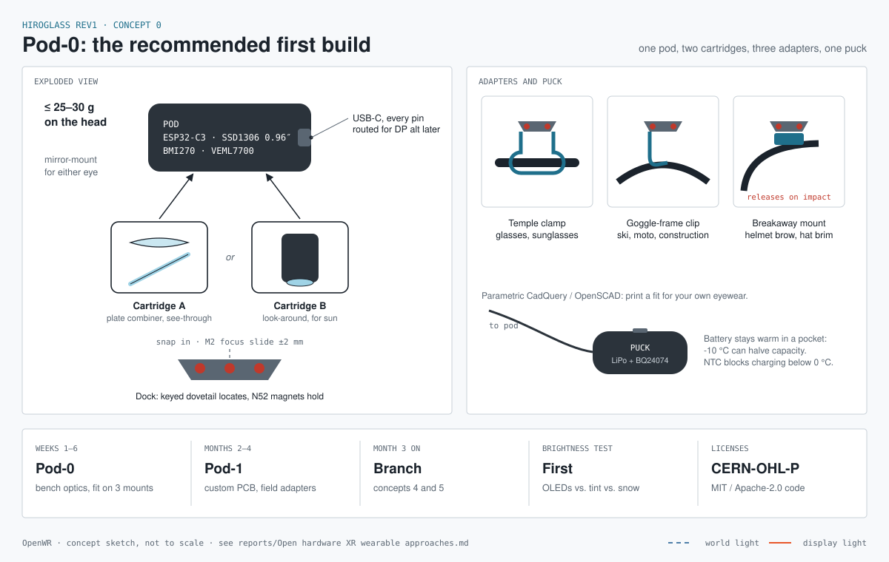
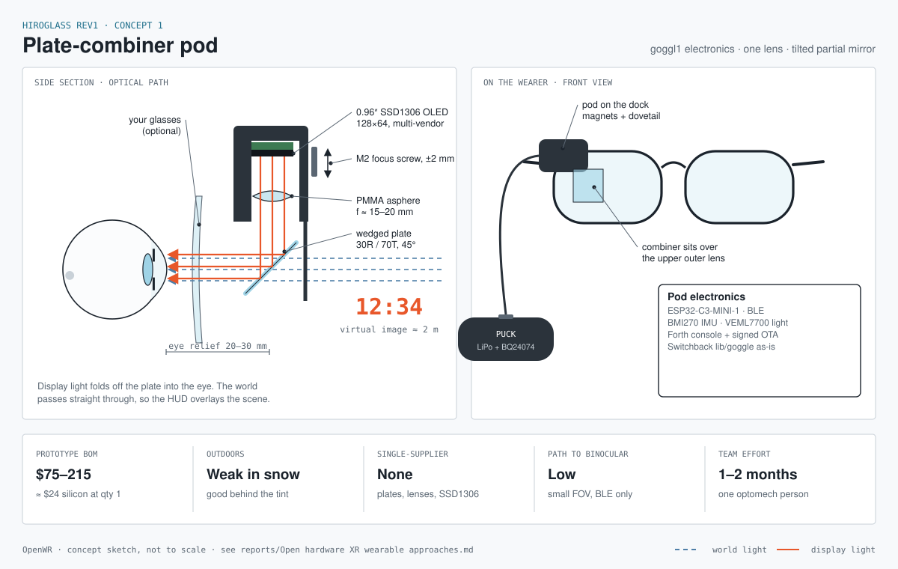
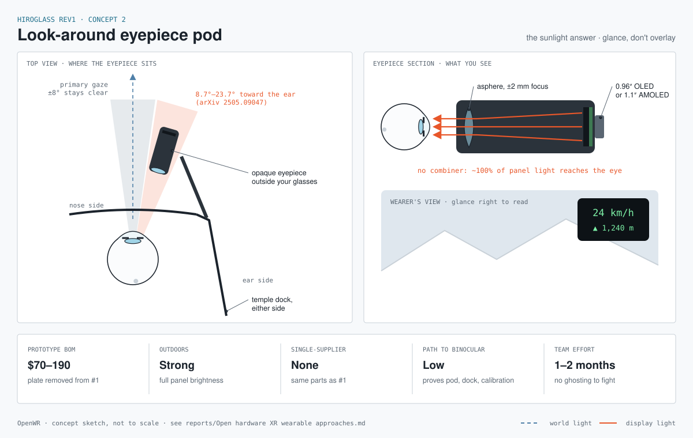
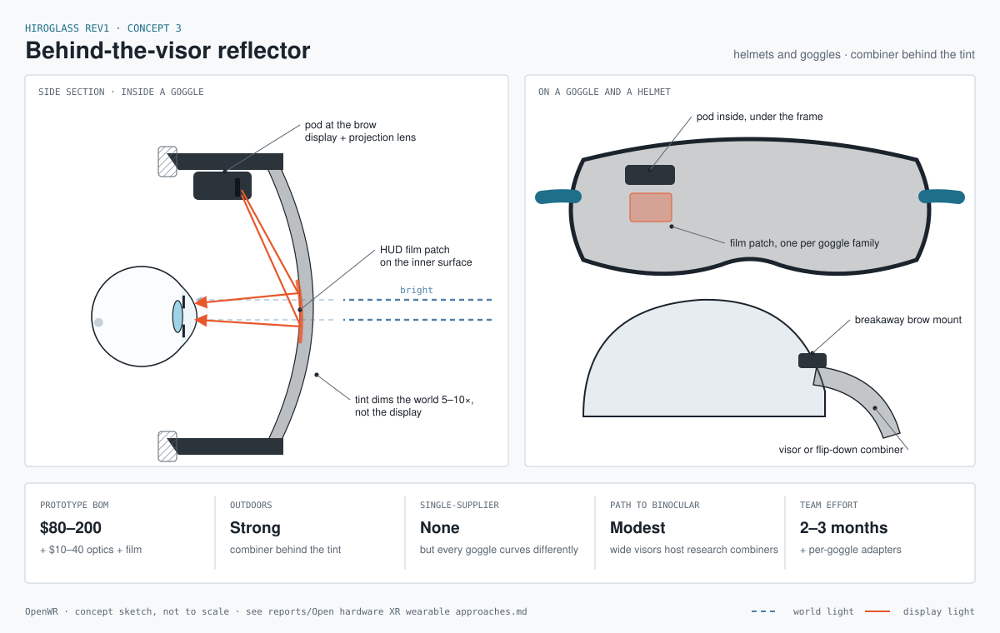
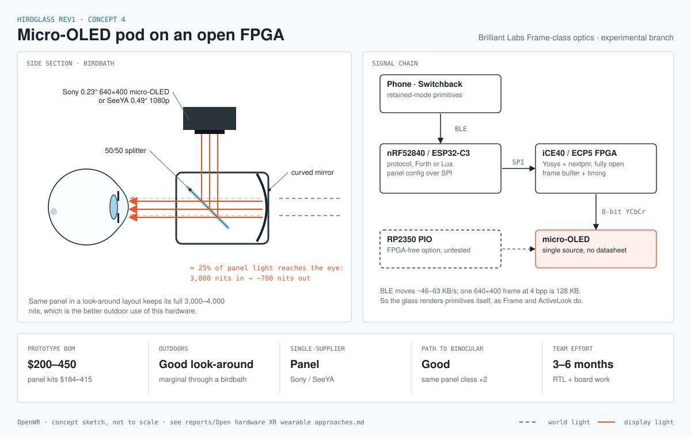
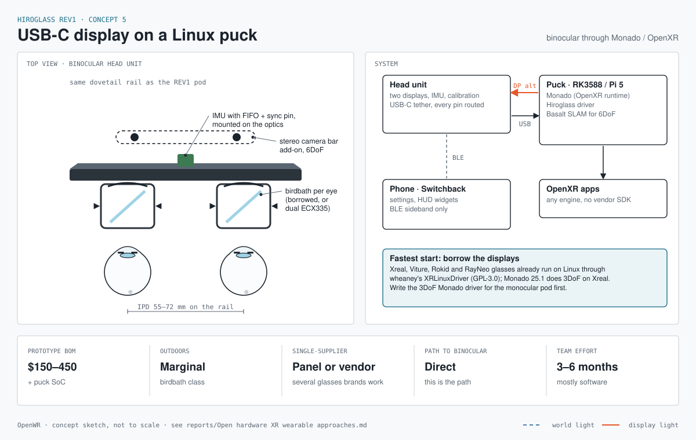

# Hiroglass REV1 concept sheets

One sheet per design approach in [the research report](../reports/Open%20hardware%20XR%20wearable%20approaches.md), plus the recommended first build. Each sheet has a technical section (optical path, top view or signal chain), the device in context, and the report's numbers for cost, outdoor readability, single-supplier parts, path to binocular and team effort.

These are concept sketches, not to scale and not CAD. They are meant for deciding between approaches, not for building from.

| Sheet | Approach |
|---|---|
| [concept-0-pod0-system.svg](concept-0-pod0-system.svg) | Pod-0, the recommended first build: one pod, two optics cartridges, three adapters, one puck |
| [concept-1-plate-combiner.svg](concept-1-plate-combiner.svg) | Plate-combiner pod: goggl1 electronics, one lens, a tilted partial mirror |
| [concept-2-look-around.svg](concept-2-look-around.svg) | Look-around eyepiece pod, the option for bright sun |
| [concept-3-visor-reflector.svg](concept-3-visor-reflector.svg) | Behind-the-visor reflector for goggles and helmets |
| [concept-4-microoled-fpga.svg](concept-4-microoled-fpga.svg) | Micro-OLED pod driven by an open FPGA |
| [concept-5-usbc-monado.svg](concept-5-usbc-monado.svg) | USB-C display on a Linux puck, binocular through Monado/OpenXR |








## Editing

The SVGs are generated. Change `make_concepts.py`, then run:

```
python3 make_concepts.py
```

It needs only Python 3. To check a sheet as an image, `rsvg-convert -w 1200 concept-1-plate-combiner.svg -o /tmp/c1.png`.
