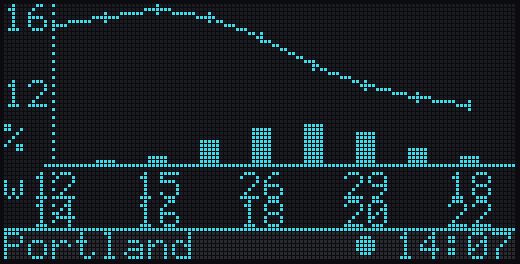
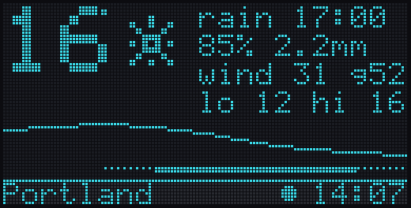
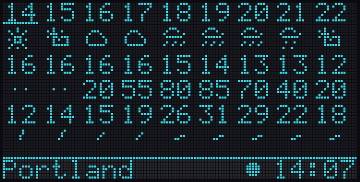
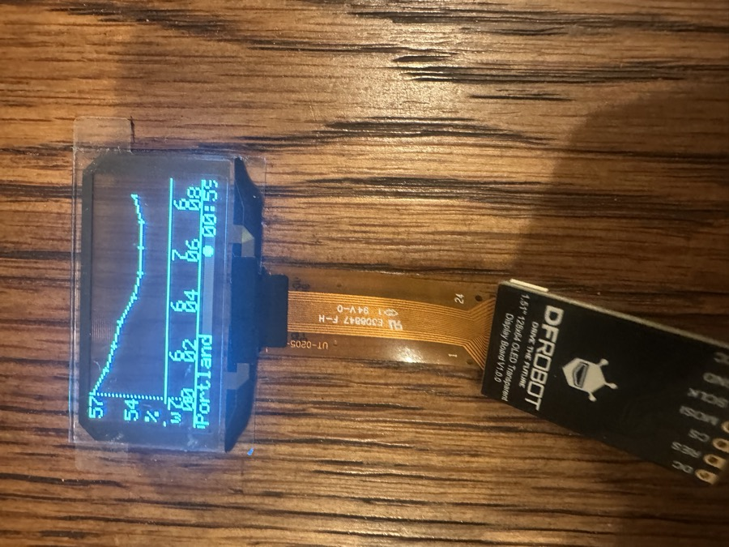
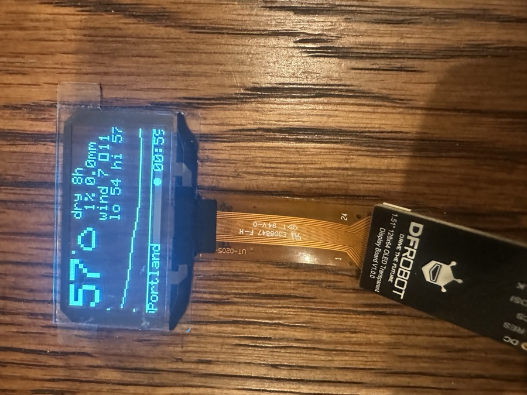
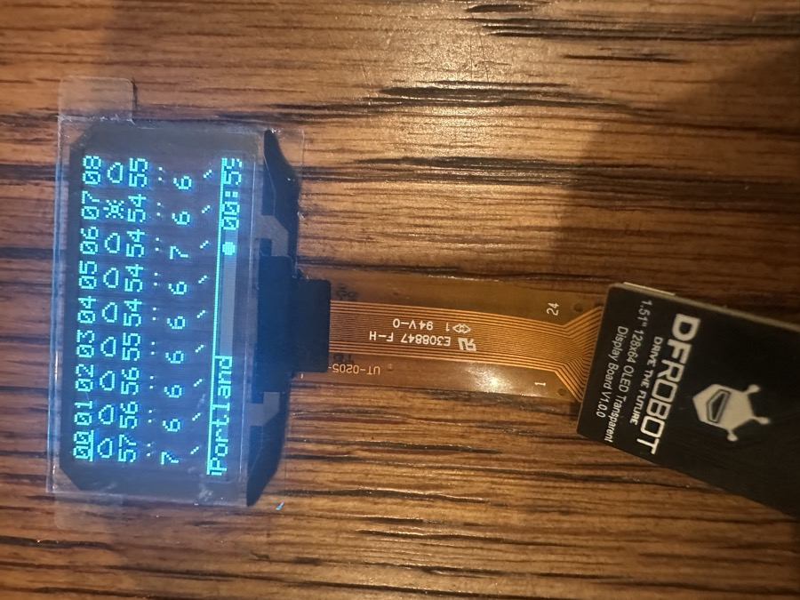

# goggl1 Weather HUD — design

**Status:** all four phases implemented and verified on hardware 2026-10-01. Phase 4 details in DESIGN-provisioning-ota.md. Reviewed against hardware findings
from 2026-10-01 (full 128×64 drives; rows 56–63 sit over the opaque strip).
**Scope:** the first *use case* hosted on the goggl1 hardware, and the
use-case hosting model it establishes for OpenWR devices.

---

## 1. What we are building

A see-through heads-up display that shows the next eight hours of weather
for wherever the wearer is, refreshed on a schedule, with three selectable
looks. The wearer never types a location: the device works it out from its
IP address, and can be corrected later from the mobile app.

The deliverable is two layers:

| Layer | Lives in | Changes how often |
|---|---|---|
| **Capability vocabulary** — WiFi, clock, geolocation, forecast fetch, icons | C, flashed firmware | Rarely. Same for every weather theme. |
| **Use case** — which data to show, where, in which theme | Forth bundle | Freely. Typed at `ok>` today, pushed OTA from the app later. |

That split is the OpenWR position in miniature: the firmware is a stable
set of things the hardware can do, and what the device *is* on a given day
is a small, replaceable script. The device hosts one use case at a time.

## 2. Use-case hosting model

```
firmware (C)                            use case (Forth bundle)
┌────────────────────────────┐          ┌──────────────────────────┐
│ goggle_words   oled-* led  │          │ manifest  name, version, │
│ net_words      wifi-* net  │  ←eval── │           requires: wx,  │
│ clock_words    clock-*     │          │           net, oled      │
│ geo_words      geo-*       │          │ theme-strip.fs           │
│ wx_words       wx-*        │          │ theme-glance.fs          │
│ scheduler      calls       │──hook──▶ │ theme-ribbon.fs          │
│   hud-tick every 60 s and  │          │ hud.fs    hud-tick,      │
│   after each data refresh  │          │           hud-draw       │
└────────────────────────────┘          └──────────────────────────┘
```

- A **bundle** is a directory of `.fs` files plus a manifest listing the
  C vocabularies it requires. It is installed with ESPIDFORTH's
  `forth_eval_rollback`, so either the whole bundle takes effect or none
  of it does and the failing line is reported.
- The firmware calls exactly one Forth entry point, `hud-tick`, and only
  if `forth_word_exists("hud-tick")`. Everything else is the bundle's
  business. A bundle that defines nothing leaves the test pattern on screen.
- Bundle storage: the console has a capture mode. Between the lines
  `bundle-begin` and `bundle-end` every line is buffered instead of
  interpreted; at the end the text is applied with rollback and, if it took,
  written to NVS and re-applied at every boot before the scheduler starts.
  The weather bundle is 104 lines, 4.2 KB with comments stripped. Phase 4
  delivers the same text over BLE; the OTA design only has to move one blob.
- One use case at a time, by construction: installing a bundle rolls back
  to a savepoint taken before the previous one.

## 3. Data: location

### 3.1 IP geolocation

The device has no GPS and asks the user for nothing. On first network
connection it resolves its public IP to a rough location. Measured
2026-10-01 from the development network:

| Service | Transport | Key | Result for this network | Notes |
|---|---|---|---|---|
| `ipinfo.io/json` | **HTTPS** | none | city, region, country, `loc` "lat,lon", timezone, postal | 50 k req/month unauthenticated. **Primary.** |
| `ip-api.com/json` | HTTP only | none | city, regionName, country, lat, lon, timezone, utc offset | HTTPS is 403 on the free tier. **Fallback**, plaintext. |
| `ipapi.co/json` | HTTPS | none | rate-limited on first call | Not used. |

Both usable services placed the development network in the right city but
about 6 km apart from each other. That is the precision class: **city**,
not street. Weather at hourly resolution does not care; a 10 km error is
inside one forecast cell for most providers.

Request: `GET https://ipinfo.io/json` with `Accept: application/json`.
Parse `city`, `region`, `country`, `loc`, `timezone`. Store
`lat`/`lon` as integers ×10 000 (4 decimals, ~11 m) in the `geo` struct.

### 3.2 Coarsening and privacy

OpenWR's principle is no third-party dependency *required*, and no data
leaving the device that does not need to. The weather use case needs two
things from the internet, and we keep each to the minimum:

1. The geolocation call sends the device's public IP, which it must. It
   is made once per association to a network, not on a timer.
2. The forecast call sends coordinates. They are **rounded to 2 decimals
   (~1 km)** before sending. The forecast is identical; the provider learns
   less.

The app (phase 3) can set the location by hand, which disables the
geolocation call entirely. `geo!` exists from phase 1 so the same override
is available at the prompt.

### 3.3 Timezone and clock

`timezone` from the geolocation response is kept only as a label. The
offset actually used for display is `utc_offset_seconds` from the forecast
response, because it is already DST-adjusted for the location and arrives
with every refresh. Wall-clock time comes from SNTP (`pool.ntp.org`), set
once at connect and resynced hourly. If SNTP has not completed, the status
strip shows `--:--` and the "now" marker is omitted rather than wrong.

## 4. Data: forecast

**Provider:** Open-Meteo, `api.open-meteo.com/v1/forecast`. No key, no
account, HTTPS, hourly resolution, global coverage, and a `forecast_hours`
parameter that returns exactly the window we display. Measured response
for the full variable set below: **1 408 bytes**. That matters on a part
with no PSRAM.

Request (one line, shown wrapped):

```
GET /v1/forecast?latitude=45.58&longitude=-122.68
    &hourly=temperature_2m,apparent_temperature,precipitation_probability,
            precipitation,rain,snowfall,wind_speed_10m,wind_gusts_10m,
            wind_direction_10m,weather_code,cloud_cover,uv_index,is_day
    &forecast_hours=9&timezone=auto&wind_speed_unit=kmh
```

`forecast_hours=9` returns the current hour plus eight: slot 0 is the hour
containing "now", slot 8 is eight hours out. All three themes index these
slots directly.

### 4.1 On-device model

Everything is integer. Floats are parsed once and scaled; Forth sees ints.

```c
typedef struct {
    int16_t temp10;      /* °C ×10          temperature_2m            */
    int16_t feels10;     /* °C ×10          apparent_temperature      */
    uint8_t pop;         /* %               precipitation_probability */
    uint16_t precip10;   /* mm ×10          precipitation             */
    uint16_t snow10;     /* cm ×10          snowfall                  */
    uint8_t wind;        /* km/h            wind_speed_10m            */
    uint8_t gust;        /* km/h            wind_gusts_10m            */
    uint16_t wdir;       /* degrees         wind_direction_10m        */
    uint8_t code;        /* WMO             weather_code              */
    uint8_t cloud;       /* %               cloud_cover               */
    uint8_t uv10;        /* ×10             uv_index                  */
    uint8_t is_day;
} wx_hour_t;                               /* 18 bytes, packed to 20 */

typedef struct {
    wx_hour_t h[9];
    int32_t   utc_offset_s;
    uint32_t  fetched_at;    /* unix seconds; 0 = never */
    uint16_t  hour0;         /* local hour of slot 0, 0..23 */
    uint8_t   valid;
} wx_t;                                    /* ~190 bytes */
```

The JSON is parsed with ESP-IDF's bundled cJSON into this struct and the
JSON buffer is freed; the struct is the only thing that persists. It is
also written to NVS after every successful fetch, so a reboot shows the
last forecast immediately, marked with its real age, instead of a blank
screen for the first thirty seconds.

### 4.2 Units

Default °C and km/h. The geolocation `country` sets `units` to imperial
for `US`, `LR`, `MM`; the app or `units!` can override. Conversion is done
at draw time in C accessor words (`wx-temp` returns °F×10 when imperial),
so themes never branch on units.

## 5. Refresh schedule

| What | When | Why |
|---|---|---|
| WiFi association | boot; retry with backoff 5 s → 5 min on loss | — |
| SNTP | on connect; every 60 min | drift is irrelevant at this precision; hourly is free |
| Geolocation | on connect, and when the public IP changes | once per network, not per interval; sends the IP |
| Forecast | on connect, then **every 15 min**; immediately after geolocation changes | Open-Meteo models update hourly; 15 min keeps the current-hour slot fresh with 96 req/day against a 10 000/day limit |
| `hud-tick` | every 60 s; after any successful fetch; on theme change; on button | the "now" marker and clock move once a minute |

Freshness is visible, not assumed. The status strip shows a filled dot
when the forecast is under 30 min old, a hollow dot when older, and `x`
when the network is down. Themes read `wx-age` and blank the numbers after
3 hours rather than show a stale forecast as current.

Failure policy: a failed fetch keeps the previous data, bumps the retry to
2 min, and tries again; after three failures the interval falls back to
15 min. Nothing is ever shown as fresh that is not.

### 5.1 Scheduler implementation

One FreeRTOS task, `wx_sched`, priority below the REPL. It owns the
network and the two HTTP clients. It calls into Forth only through
`forth_eval("hud-tick")` under the engine lock, which ESPIDFORTH 0.5
already serializes against the console. The REPL therefore stays
responsive during a fetch, and a theme can be redefined at the prompt
between ticks.

Heap: TLS handshake on the C3 needs ~40 KB transiently. With WiFi on, free
heap after init is expected around 90 KB, so the Forth dictionary heap
drops from 100 KB to **64 KB**. A theme is a few hundred cells; this is
not a constraint.

## 6. The Forth vocabulary added for this use case

```
\ network
net-ok?      ( -- flag )         associated and has an IP
wifi!        ( ssid u pass u -- ) store credentials in NVS, reconnect
net-ip       ( -- a b c d )

\ clock
clock-ok?    ( -- flag )
clock-hm     ( -- h m )          local time
clock-s      ( -- unix )

\ location
geo-ok?      ( -- flag )
geo-lat      ( -- n )            ×10000
geo-lon      ( -- n )            ×10000
geo-city     ( -- c-addr u )
geo!         ( lat lon -- )      manual override, persisted; disables lookup
geo-fetch    ( -- flag )

\ forecast — i is the hour slot 0..8
wx-ok?       ( -- flag )
wx-age       ( -- s )            seconds since fetch, or -1
wx-hour0     ( -- h )            local hour of slot 0
wx-temp      ( i -- t10 )        in current units ×10
wx-feels     ( i -- t10 )
wx-pop       ( i -- % )
wx-precip    ( i -- mm10 )
wx-snow      ( i -- cm10 )
wx-wind      ( i -- v )          km/h or mph
wx-gust      ( i -- v )
wx-wdir      ( i -- deg )
wx-code      ( i -- wmo )
wx-cloud     ( i -- % )
wx-uv        ( i -- uv10 )
wx-day?      ( i -- flag )
wx-fetch     ( -- flag )         synchronous; the scheduler calls this too
units!       ( 0|1 -- )          0 metric, 1 imperial, persisted

\ drawing helpers (C, because bitmaps are awkward to type)
wx-icon      ( code x y -- )     8×8 glyph for a WMO code
wx-icon2     ( code x y -- )     16×16
wx-arrow     ( deg x y -- )      wind direction tick, 7 px

\ use case
theme!       ( n -- )            0 strip, 1 glance, 2 ribbon; persisted
theme@       ( -- n )
```

Thirty-one words. All pop their arguments and push results; none block
except `wx-fetch` and `geo-fetch`, which exist for interactive debugging.

## 7. The three themes

All three were rendered with the real driver on the host against one
fixture: an autumn afternoon at 14:07, 16 °C falling to 12 °C, rain
arriving at 17:00 with 85 % probability, wind rising to 31 km/h gusting
52. Renders are in `docs/images/`, produced by `tools/hud_mock.py`. The
lit-pixel counts are measured, not estimated.

Common to all three:

- **Rows 0–55** are the see-through area and hold the forecast.
- **Rows 56–63** are over the opaque strip and hold the shared **status
  strip**: city on the left, freshness dot and local clock on the right.
  It is drawn by one word, `hud-status`, that every theme calls last.
- Every lit pixel occludes the world behind it. Themes are judged on how
  little they light; all three stay under 18 % of the panel.
- Theme switch: short press of BOOT cycles 0 → 1 → 2 → 0 and persists.
  `theme!` from the prompt or app does the same.

### 7.1 Strip — the instrument



A chart. Time runs left to right across nine columns 13 px apart. From
the top: temperature as a line with the window's high and low labelled at
the left; precipitation probability as bars from a baseline; wind speed
every two hours; hour labels every two hours. A dotted vertical line marks
the current hour.

- For: the wearer who wants the shape of the afternoon in one glance,
  cyclists, anyone deciding *when* to go out.
- Lit: **13 %** (823 px in the HUD area). The lightest theme.
- Weakness: numbers are small; the temperature line needs the labels.

### 7.2 Glance — the headline



Big numbers and one sentence. The current temperature at 3× scale with a
16 px condition icon beside it, and on the right the three facts that
change a decision: when rain starts and how much, the strongest wind and
gust, the window's low and high. Underneath, a temperature sparkline with
a rain band beneath it: solid where probability is 50 % or more, dotted
from 20 %.

- For: walking around. Readable in under a second, which is what a HUD
  in front of your eye has to be.
- Lit: **16 %** (1 012 px). The 3× digits are most of it.
- Weakness: no per-hour detail beyond the sparkline.

### 7.3 Ribbon — the hourly strip



The phone weather app's hourly scroller, all nine hours at once. Nine
columns of 14 px, each a stack: hour, 8×8 condition icon, temperature,
precipitation probability (a dot pair under 20 %), wind speed, and a
direction tick. The current hour's label is underlined.

- For: planning. Every number for every hour is on the glass.
- Lit: **17 %** (1 155 px). Densest in information per pixel.
- Weakness: busiest. Icons at 8 px are suggestive, not literal.

### 7.4 On the glass

Photographed 2026-10-01 with live data (Portland, imperial units chosen
automatically from the country code, SNTP clock, filled freshness dot):





Two layout corrections came out of these: Glance now writes wind as
`7/11` (speed/gust) because the `g` glyph read as a zero, and Strip's wind
and hour rows were separated by one pixel.

### 7.5 Motion

Added 2026-10-01. A fourth file, `30-anim.fs`, defines `hud-anim`; the
scheduler calls it every 200 ms when it exists. A frame is the theme redrawn
plus a particle layer picked from the current hour's conditions:

| Condition (WMO code) | Effect |
|---|---|
| drizzle, rain, showers (51–67, 80–82) | up to 10 drops fall 3 px a frame, leaning with the wind; count rises with probability |
| snow (71–77, 85, 86) | flakes drift down 1 px and wander sideways |
| thunderstorm (95+) | rain, and one frame in twenty inverts the panel |
| fog (45, 48) | three dotted bands whose phase slides |
| clear (0, 1) at night | eight stars, each lit three frames in four |
| wind 20 km/h or more, otherwise | six streaks blow right to left, faster in more wind |

Each theme adds one flourish of its own driven by the frame counter: Strip's
now-line marches, Glance's sparkline endpoint pulses and its rain band
crawls, Ribbon's current-hour underline runs. The panel dims to contrast 48
after dark. Measured: 4.7 ms per animated frame; the layer is 70 words and
2.4 KB of the 6.7 KB bundle. `fx-code` forces a condition for demos and
`anim-on` switches the layer off.

### 7.6 Why three, and why these three

They answer three different questions with the same data: *what is the
shape of the next eight hours* (Strip), *what do I need to know right now*
(Glance), *what exactly happens at 19:00* (Ribbon). Supporting all three
costs about 350 lines of Forth in total and no firmware changes, which is
the point of the hosting model: themes are cheap, so the user picks.

## 8. Phasing

| Phase | Delivers | Verified by |
|---|---|---|
| **1. Capabilities** | WiFi + NVS credentials, SNTP, geolocation with fallback, forecast fetch and parse, NVS cache, scheduler, the 31 words, icon glyphs | `wx-fetch .` at the prompt; `test-wx` word asserting a parse of a stored fixture response |
| **2. Themes** | `hud.fs` with `hud-status`, `hud-tick`; `theme-strip.fs`, `theme-glance.fs`, `theme-ribbon.fs`; `theme!`; BOOT cycling | Host render of each theme matches `docs/images/` within tolerance; photo of each on the glass |
| **3. Bundles** | Manifest format; install via `forth_eval_rollback`; bundle in NVS, re-applied at boot; `units!`, `geo!` persisted | Reboot shows the forecast and theme without USB |
| **4. App + OTA** | BLE provisioning of WiFi, location, units, theme; bundle push; firmware OTA | Separate design |

Phase 1 is the only one that touches C. Phases 2 and 3 are Forth and
storage. The mock tool is the regression test for phase 2: it links the
same `ssd1309.c` the device runs, so a layout that fits on the host fits
on the glass.

## 9. Open questions

1. **ipinfo.io's unauthenticated quota** is 50 k/month per source IP,
   which is fine for a device making one call per network join. Confirm
   the terms allow embedded use without attribution on screen.
2. **°F display width.** Three-digit temperatures (100 °F+) push Ribbon's
   14 px columns. Either drop to 8 columns in imperial or accept a 2-digit
   cap with `99+`. Decide when imperial is implemented.
3. **Snow.** The fixture has none. Ribbon shows snowfall in the
   precipitation row when `wx-snow` is non-zero (cm instead of %); Strip
   and Glance need a snow variant of the rain band. Design when there is
   a snow fixture to render.
4. **Night contrast.** `is_day` is available per slot; whether to lower
   `oled-contrast` after dark is a wearer-comfort question for the glass.
5. **Button semantics** once more use cases exist: short press is theme
   within the use case; long press is reserved for the use-case switcher.

## 10. Reference measurements

| Item | Value | Source |
|---|---|---|
| Open-Meteo response, 13 variables × 9 h | 1 408 bytes | curl, 2026-10-01 |
| ipinfo.io response | ~400 bytes | curl, 2026-10-01 |
| ip-api.com HTTPS on free tier | 403 | curl, 2026-10-01 |
| Current firmware, WiFi off | 220 KB flash, 68 KB static RAM, 157 KB free heap | build + `chip-info` |
| Theme lit pixels (strip / glance / ribbon) | 823 / 1 012 / 1 155 of 7 168 | `tools/hud_mock.py` |
| Full-frame SPI flush at 4 MHz | ~2 ms | driver comment, unmeasured |
