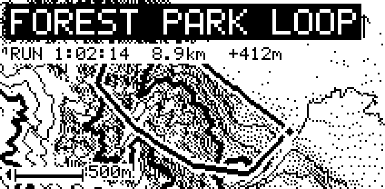
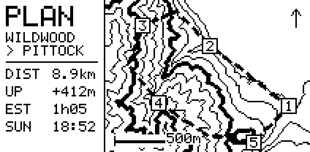
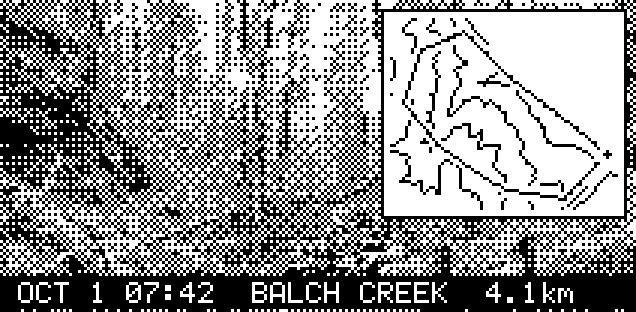

# maplet — session maps on e-paper (design)

**Status:** design and first build, 2026-10-02. Firmware runs on the XIAO
ESP32S3 Sense: boots, console over USB and BLE, Postcard mockup pushed to
the panel with `tools/push_map.py` and kept in slot 1. Phone side in Switchback.
**Hardware (primary):** Seeed XIAO ESP32S3 Sense (OV2640 camera, microSD,
8 MB PSRAM, 8 MB flash) + XIAO ePaper Breakout Board (SKU 105990172) + 2.13"
flexible monochrome e-paper, 212×104 (SKU 104990847, UC8151-class controller,
the panel GxEPD2 calls `213_flex`). The XIAO ESP32C3 is kept as a second
PlatformIO env (`xiao_c3`) for the camera-less builds.
**Lineage:** the ESP_Skin prototypes in this repo (raw driver, GxEPD2
driver); the goggl1 firmware for everything that is not the display.

## 1. What it is

A patch of e-paper you wear or clip on. Before a session it shows the map
of where you are going; after, the map of where you went, with the track,
the contours, and the numbers. It never updates live: e-paper takes two
seconds and a flash to refresh, and the goggle is the live display. It
holds its image with no power, so the last session is on your sleeve until
the next one.

Everything hard happens on the phone. maplet is a frame: it receives a
finished 212×104 bitmap over the same Forth console goggl1 has, shows it,
and keeps the last few in flash.

## 2. Where the map comes from

Free and open, verified live for Portland on 2026-10-02:

| Source | Role | Terms |
|---|---|---|
| **AWS Terrain Tiles** (Terrarium PNG, 256 px, zoom to 15; 3DEP in the US, SRTM/Copernicus elsewhere) | elevation grid: contours, hillshade, slope, profile | free, no key, attribution line |
| **USGS 3DEP** via EPQS | spot elevations when a single number is wanted | public domain |
| USGS Topo basemap tiles | optional backdrop on the phone | public domain |

Terrain Tiles are the base. A session's bounding box at zoom 14 is a few
95 KB tiles, decoded on the phone into metres per pixel; contours come from
marching squares at an interval chosen for the terrain (10 m in the city,
50 m in the mountains), hillshade from the gradient. Tiles are cached, so a
region you ride often is offline after the first time.

Nothing in this is road data. OSM trails can be layered later if wanted.


## 3. Three plans for the experience

Real renders at the panel's resolution, from twelve zoom-14 AWS Terrain
Tiles over Forest Park, Portland, drawn with the firmware's font5x7. The
raster work (hillshade, dither, marching-squares contours, track) is in
`tools/render/maplet_render.p` (Pop-11); `tools/render/compose.py` adds
text and the photo. Full-size PNGs in `docs/images/`.

### Plan 1 · Postcard (after the session) — build this first



At **Stop**, the phone renders the loop you just did: hillshade, contours,
the track as a 3 px line with a start ring and end dot, an inverted banner
with the place, and a stats line (time, distance, climb). One flash, then
it stays until the next session. C3 build, no new firmware words. Any past
session in the log can be sent again.

### Plan 2 · Field Notes (before the session)



A notebook page: a notes column on the left (plan name, distance, climb,
estimated time from your average pace for that sport, sunset) and the
route on the right as a dashed line with numbered waypoints over contours.
From **Plan** / **Map where I am** on the Session tab. Same build as
Postcard. Optionally flips into a Postcard at Stop.

### Plan 3 · Snapshot (during the session, S3 Sense)



The S3 Sense takes its own pictures: on `cam-snap` (phone tap or device
button) it grabs a frame, dithers it to one bit (ordered dither reads
better than error diffusion for photos on this panel), drops in the 76×64
minimap inset the phone sent at Start, stamps time and distance from the
`sess!` stream, shows it, and writes it to the SD card as the session's
roll. At Stop the phone pulls the roll over BLE for the session gallery.

| | Postcard | Field Notes | Snapshot |
|---|---|---|---|
| Moment | after | before | during |
| Board | C3 | C3 | S3 Sense |
| Renders | phone | phone | phone inset, device photo |
| BLE bytes | 2 808 in | 2 808 in | 608 in; 2 808 out per frame |
| Flashes | 1 | 1 (2 with flip) | per snapshot |
| SD | no | no | yes |
| New words | none | none | `cam-snap`, `epd-photo`, `roll-ls`, `roll-get` |

**Recommendation:** Postcard first. It builds the renderer, the tile cache
and the second-device console, which the other two reuse.

## 4. How the picture is made

Parameters that read well at one bit on this panel, from the mockups:

1. Tiles: Terrarium PNG, zoom 14 in the city (13.6 m/px on the canvas),
   zoom 13 in the mountains. `elev = (R*256 + G + B/256) - 32768`.
2. Grid: the track's box padded 10 %, widened to 212:104, bilinear sample.
3. Hillshade: Lambert from the gradient, relief ×2, light from the
   west-southwest (the Tualatin ridges run NW–SE, so NW light is flat).
   Only slopes darker than flat ground take ink.
4. Dither: Floyd–Steinberg on the shade, gain 1.4, capped at 75 % ink.
5. Contours: marching squares at 25 m, every fourth (100 m) drawn 3 px.
   Interval scales with relief: 10 m under 100 m of range, 50 m over 600 m.
6. Track: Bresenham 3 px over a 7 px white halo; ring at start, dot at
   end; a planned route is dashed.
7. Furniture: 500 m scale bar bottom-left, north arrow top-right, 5×7 text
   at 2× for the banner, 1× for stats.
8. Pack: 27 bytes/row, MSB first, 1 = black, 2 808 bytes, 36 hex lines of
   80 bytes via `epd-hex!`; the driver rotates to native 104×212 on
   `epd-show`.

## 5. Hardware: XIAO ESP32S3 Sense

Env `xiao_s3_sense` (default). Breakout → S3 GPIO: RST 1, CS 2, DC 4,
BUSY 6, SCK 7, MOSI 9; BOOT button GPIO0; USB on 19/20 (never touched).
The Sense's microSD shares the SPI bus with CS on GPIO21 (also the user
LED, so no LED); the OV2640 has its own pins. 8 MB flash: two 3 MB OTA
slots plus a 1.9 MB `maps` partition (`partitions_s3.csv`); octal PSRAM on.
.mnpkg chip 0x0004, board 0x0408 `xiao-esp32s3` (proposed). Flashing on
macOS needs 115200 baud (`upload_speed` in platformio.ini); at 460800 the
USB-serial-JTAG drops the data phase with "No serial data received".
Still to add: esp32-camera and SD components and the Snapshot words.

## 6. The device contract

The console goggl1 already has, plus a small e-paper vocabulary:

```
epd-clear      ( -- )              white canvas
epd-cursor!    ( n -- )            byte cursor into the canvas, 0 = top-left
epd-hex!       ( c-addr u -- )     append bytes given as hex text at the cursor
epd-str        ( c-addr u x y -- ) 5x7 text, for the device's own messages
epd-line / epd-box / epd-pixel     as on the goggle
epd-show       ( -- )              full refresh (about 2 s), then panel sleep
epd-save       ( n -- )            keep the canvas as map n in flash (0..3)
epd-load       ( n -- flag )       bring map n back to the canvas
epd-slot@      ( -- n )            last slot saved
epd-splash     ( -- )              the boot picture
cam-snap       ( -- flag )         S3: grab a frame into PSRAM          (planned)
epd-photo      ( x y w h -- )      S3: dither the frame into the canvas (planned)
roll-ls        ( -- )              S3: list the session roll on SD      (planned)
roll-get       ( n -- )            S3: print bitmap n as hex lines      (planned)
```

The canvas is landscape, 212 wide by 104 tall, 27 bytes a row, MSB first,
1 = black (the natural way to draw). The driver rotates to the panel's
native 104×212 on `epd-show`. A full picture is 2 808 bytes; as hex over
BLE in 80-byte lines that is 36 lines and about three seconds. At boot the
device shows the last saved map, or its splash if there is none.

## 7. Phone side

- Sessions record the GPS track (they already compute distance from it).
- A session's detail screen renders the map and offers **Send to maplet**.
- Pairing: maplet advertises as `maplet` with the same window rules as the
  goggle (power-up, and after a drop). Switchback keeps one console per
  device; the Pair screen lists both kinds.
- Pre-session: **Map where I am** on the Session tab.

## 8. What it is not, yet

Live updates (the goggle's job), partial refresh (this panel's LUT does a
full flash; fine for a patch), a user button (the XIAO has none; the app
flips maps), and trails from OSM.
